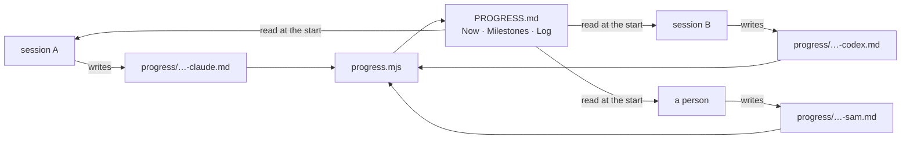

<div align="center">

# agent-progress-log

**A Claude skill for repos that more than one agent works in: an append-only log, and a status page generated from it.**

Every session adds one small file. `PROGRESS.md` is built from those files and never edited by hand,
so two sessions writing at the same moment make two files, not a merge conflict.


</div>

---

## The problem

| what happens with a hand-edited `STATUS.md` | what happens here |
|---|---|
| two sessions edit the same lines; the later one wins and nobody notices | each session writes its own file; nothing is overwritten |
| "all tests pass" stays in the file long after it stopped being true | each entry states its checks as run **in that session**: green, red or not run |
| a failed session leaves no trace, and the next one tries the same thing | a failed session still writes "tried X, failed because Y" |
| "done" means whatever the writer felt | a milestone has a demo, and is not done while a check is red |

## What it looks like

A session ends by writing one file, `progress/20260303T083000Z-claude.md`:

```markdown
---
at: 2026-03-03T08:30:00Z
agent: claude
milestone: M1
done: true
tests: green
lint: green
---

**Did:** Fixed quoted commas in `readCsv` (the reader now tracks open quotes). All 1,000 rows land; 9 of 9 tests pass.
**Next:** M2: draft the weekly report query and compare its totals with the spreadsheet by hand.
**Blockers:** The report's logo file: a person has to supply it.
```

`node scripts/progress.mjs` then writes `PROGRESS.md`. This is the real output for the project in
[`example/`](example/):

> ## Now
>
> **Milestone:** M1 · **last touched by:** claude · 2026-03-03T08:30:00Z
>
> **Next action:** M2: draft the weekly report query and compare its totals with the spreadsheet by hand.
>
> **Blocked on:** The report's logo file: a person has to supply it.
>
> ## Milestones
>
> | | Name | Demo | State | tests | lint |
> |---|---|---|---|---|---|
> | M0 | Skeleton | `npm start` prints the version | ✅ done | 🟢 green | 🟢 green |
> | M1 | Import | a CSV of 1,000 rows lands in the database | ✅ done | 🟢 green | 🟢 green |
> | M2 | Report | the weekly PDF opens and the totals match | not started | — | — |

followed by the full log, newest first ([see the whole page](example/PROGRESS.md)).



## Install

There are two parts, and a project needs only the second:

```bash
# 1. the skill, so Claude knows when to read the page and how to end a session
git clone https://github.com/DevCrazyCube/claude-skill-agent-progress-log ~/.claude/skills/agent-progress-log

# 2. the script, once per project, so every agent, person and CI job can run it
mkdir -p scripts && cp ~/.claude/skills/agent-progress-log/scripts/progress.mjs scripts/
```

No packages to install. Node 18 or newer. The script works on its own, without the skill.

## Use

Run everything from the project root.

**1. Start a fragment for this session.** It prints the new file's path, and creates `progress/` if needed:

```console
$ node scripts/progress.mjs new --agent claude --milestone M1 --tests green
progress/20260303T083000Z-claude.md
```

**2. Fill it in.** This is the file it wrote:

```markdown
---
at: 2026-03-03T08:30:00Z
agent: claude
milestone: M1
tests: green
lint: not-applicable
---

**Did:** 
**Next:** 
**Blockers:** nothing
```

`Did` and `Next` are required: `--check` fails on a fragment that leaves one empty. `Blockers` stays `nothing` when
nothing needs a person.

**3. Generate the page:**

```console
$ node scripts/progress.mjs
PROGRESS.md ← 3 fragment(s)
```

**4. Commit** the fragment, `PROGRESS.md` and (the first time) `progress.config.json`.

| option of `new` | meaning |
|---|---|
| `--agent <name>` | who wrote it (required; letters, digits, `-`, `_`) |
| `--milestone <id>` | the milestone this session worked on |
| `--done` | the milestone's demo was run and worked |
| `--<check> green\|red\|not-applicable` | one per name in `checks`; a check you leave out is written as `not-applicable` |

The fragment of the session you are in is yours to edit until you commit it: forgot `--done`, add `done: true` to
its front matter. A committed fragment is never edited; write a new one.

### In CI

`--check` writes nothing. It exits 0 when `PROGRESS.md` is exactly what the fragments generate and every fragment
is well formed, 1 when not, and 2 on an error such as an unreadable config. The page carries no timestamp of its
own, so the same fragments always give the same bytes.

```yaml
# .github/workflows/progress.yml
name: progress
on: [push, pull_request]
jobs:
  check:
    runs-on: ubuntu-latest
    steps:
      - uses: actions/checkout@v4
      - uses: actions/setup-node@v4
        with: { node-version: 20 }
      - run: node scripts/progress.mjs --check
```

<details>
<summary><b>Configuration: <code>progress.config.json</code></b></summary>

The file lives in the folder you run the script from, normally the project root. Every key is optional. Without
the file you get a plain log with no milestone table.

```json
{
  "title": "Paper Boat",
  "dir": "progress",
  "out": "PROGRESS.md",
  "milestones": [
    { "id": "M0", "name": "Skeleton", "demo": "`npm start` prints the version" },
    { "id": "M1", "name": "Import",   "demo": "a CSV of 1,000 rows lands in the database" }
  ],
  "checks": ["tests", "lint"]
}
```

Give every milestone a **demo**: the thing someone can see when it is done.

</details>

<details>
<summary><b>What <code>--check</code> reports</b></summary>

- `PROGRESS.md` differs from what the fragments generate
- a fragment without `at:` or `agent:`
- a milestone id that is not in the config
- a check that is not stated, or is not one of `green`, `red`, `not-applicable`
- a fragment without a `**Did:**` or a `**Next:**` line, or with one left empty

The same problems are printed as warnings on a normal run; the page is still written.

</details>

<details>
<summary><b>The rules the skill gives Claude</b></summary>

- One fragment per session.
- Append-only: an earlier fragment is never edited, also not to correct it.
- `PROGRESS.md` is never edited by hand.
- A failed session still gets a fragment.
- A check is red until it was seen green in this session.
- Blockers are things only a person can supply.

</details>

## Tests

```bash
node --test tests/progress.test.mjs
```

Nine tests: parsing (comments, missing front matter), the "Now" block, the milestone table, done-with-a-red-check,
every malformed-fragment message, a fragment nobody filled in, never overwriting a fragment written in the same
second, and the command line
end to end.

## Repo layout

```
SKILL.md                  what Claude reads: when to read the page, how to end a session
scripts/progress.mjs      the generator, the `new` command and `--check`
tests/progress.test.mjs   9 tests, node:test, no dependencies
example/                  a made-up project: config, three fragments, the generated page
```

## License

MIT
